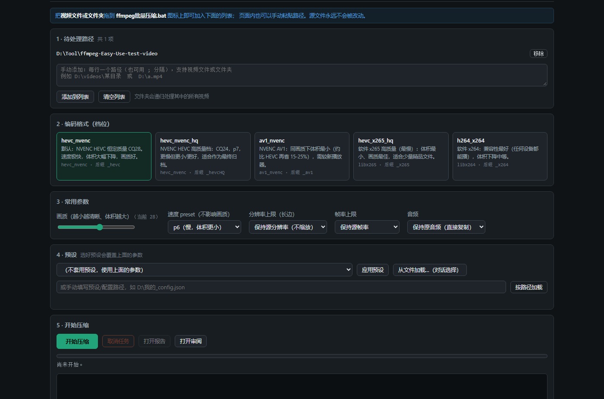
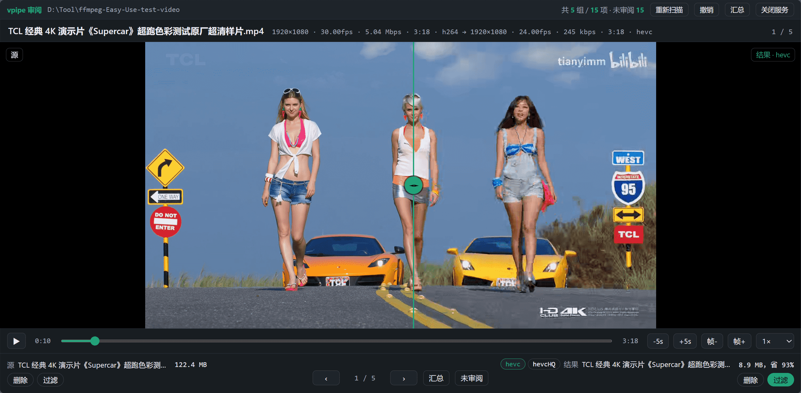
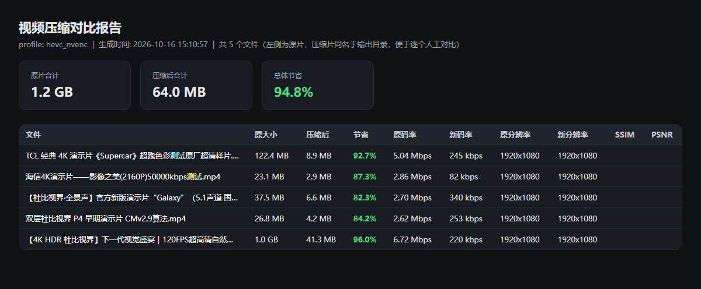

# ffmpeg-Easy-Use · 视频批量压缩-审阅

把编码、封装、分辨率各异的视频批量压小；压完打开审阅页，左右并排确认效果，决定删除或过滤。

## 快速开始

1. **获取**：`git clone https://github.com/ADNdlc/ffmpeg-Easy-Use.git`，或在页面右上角 **Code → Download ZIP** 后解压。
3. **初始化**：双击 `初始化.bat`。它扫描机器上的 ffmpeg：扫到就记下它所在目录直接复用，没扫到就询问是否下载到 `<仓库>\bin`；随后就地生成 `core\config.json`。
4. **使用**：把视频或文件夹拖到 `ffmpeg批量压缩.bat` 上，在打开的页面里点「开始压缩」。默认档位（HEVC / NVENC）适合大多数情况，可以什么都不调。

需要 Windows 10+ 与 Python 3，见文末「依赖」。以后重新拉取代码或移动了仓库位置，再双击一次 `初始化.bat` 即可。

---

## 界面与使用


### 压缩设置页面



- 拖单个或多个视频：逐个压缩；拖文件夹：递归处理其中所有视频。

- 结果保存在源文件同目录，文件名加档位后缀，如 `video.mp4` → `video_hevc.mp4`

- 每个被处理的目录是一个独立工作区，产物都留在该目录内：

	```
	<目标目录>\report_<档位>.html / .csv   ← 体积对比报告
	<目标目录>\审阅.bat                    ← 审阅入口
	<目标目录>\.data\                      ← 每个文件的编码日志与状态 json
	```

- **处理列表**：可同时添加多个路径，会按顺序处理。服务已在运行时再拖入路径，会追加到列表并自动刷新已打开的页面；关掉窗口即结束服务。

- 点「开始压缩」执行，下方日志实时输出信息。
---


### 审阅页面



每次压缩完成后会在工作区根目录生成 `审阅.bat`，双击打开审阅页面。

- 打开一个只监听 `127.0.0.1` 的本地网页：左侧源视频、右侧转换结果，按下中间绿色按钮，分界线跟随鼠标移动，两边同步播放、暂停、拖动进度与逐帧。
- 若同一目录有**多个转换结果**，可用右下角视频名字旁的按钮切换对比项。
- 每一项（**源**、**每个结果**）各有两个**互不影响**的开关：
	- **删除**：汇总确认后送入 **Windows 回收站**（可还原），不直接删除；
	- **过滤**：标记为「不需要转换」，之后 `drag` / `scan` / `encode` 都自动跳过。
- 默认状态：源不带过滤，结果自带过滤（结果不会作为待处理输入，免得把产物再压一遍）。
- 快捷键 `D` / `Shift+D` 切删除，`F` / `Shift+F` 切过滤，`Ctrl+Z` 撤销，`,` / `.` 切组，`S` 汇总。
- 点**「汇总」列出删除清单与保留清单**，确认后执行；执行前逐项校验，文件已被改动或消失的项会跳过并说明原因。
- 删除某个源、而该组已无任何保留结果时，要求**显式确认**，避免把一组删成空壳。
- 不想要审阅功能：`config.json` 里设 `"review_enabled": false`。状态在 `<目标目录>\.data\review.json`，原子写入，损坏会自动备份并重建。
---
### 汇总报告

每次压缩完成后，会在目标目录生成体积对比报告，汇总整体节省与逐文件明细：



---


## 压缩档位

内置几个预设配置：

| profile | 编码器 | 特点 |
|------|------|------|
| `hevc_nvenc`（默认） | hevc_nvenc | 速度极快，体积大幅下降 |
| `hevc_nvenc_hq` | hevc_nvenc | CQ24 / p7，更小更好，稍慢 |
| `av1_nvenc` | av1_nvenc | 同画质体积最小，需较新播放器 |
| `hevc_x265_hq` | libx265 | 最慢，体积最小、画质最佳 |
| `h264_x264` | libx264 | 兼容性最好，体积下降中等 |


## 命令行

```powershell
cd "<仓库>\core"

python compress_gui.py                              # 图形入口，等同于拖入
python compress_gui.py --open "D:\videos\视频.mp4"   # 服务已在运行则追加路径
python compress_gui.py --stop                       # 关闭入口服务

python vpipe.py drag --profile av1_nvenc "D:\videos\视频.mp4" "D:\videos\目录"
python vpipe.py drag --profile hevc_nvenc --max-long-side 1280 --max-fps 30 "D:\videos\目录"
python vpipe.py drag --no-gpu "D:\videos\视频.mp4"   # 纯软件解码/缩放

python vpipe.py scan                                  # 扫描待处理文件
python vpipe.py plan --profile hevc_nvenc             # 规划，逐条列出将采用的加速模式
python vpipe.py encode --profile hevc_nvenc           # 编码，断点续跑；--force 强制重编
python vpipe.py report --profile hevc_nvenc --quality # 出报告，附带 SSIM/PSNR

python review.py --work "D:\videos\目录"              # 审阅服务，review.py --stop 关闭
```


## 目录结构（仓库）

```
ffmpeg-Easy-Use\
├─ 初始化.bat                ← 原地初始化运行环境
├─ ffmpeg批量压缩.bat        ← 统一入口，拖入即用
├─ 打开命令行(高级).bat
├─ install\install.ps1       ← 初始化脚本本体
├─ README.md
├─ docs\images\              ← 本 README 的配图
└─ core\                     ← 程序与默认配置
    ├─ compress_gui.py / vpipe.py / review.py
    ├─ gui_page.html / review_page.html
    ├─ config.example.json   ← 配置模板（入库）
    ├─ config.json           ← 初始化后就地生成（被 .gitignore 忽略）
    └─ 默认预设_config.json
```

初始化**不复制任何文件**，初始化若下载了 ffmpeg 会放进 `<仓库>\bin\`，工作目录是 `<仓库>\core\_work`。程序内部一律按“脚本自身目录”相对定位，所以 `core\` 里的脚本、`config.json`、两个 `.html` 和预设必须待在同一目录。


## GPU 加速（默认开启）

解码与缩放优先交给显卡，**编码档位本身不变**。三级自动降级：全 GPU（NVDEC + CUDA 缩放）→ 仅 GPU 解码 → 纯软件，哪一级不适用就自动换下一级，不会因为开了 GPU 而编不出文件。

`hevc_x265_hq` / `h264_x264` 这两个软件档位只加速解码。要压帧率时也不走全 GPU，因为 `fps` 滤镜不认显存帧。关掉：命令行加 `--no-gpu`，或 `config.json` 里设 `"gpu": {"enabled": false}`。

它减轻的是 CPU 压力，不等于提速：瓶颈通常落在编码器上，想缩短总耗时先调「压缩档位」一节的参数。


## 输出与安全

- **原子输出**：先写 `源名_<tag>.part.mp4`，编码成功才改名为成品；失败或中断会删掉 `.part`，所以目录里不会留半截文件，重编失败也不会毁掉已有成品。
- **断点续跑**：成品已存在且时长一致就跳过，重编加 `--force`。
- **不重复处理**：已生成的后缀产物、被标记「过滤」的文件都会被自动跳过（`--include-filtered` 可临时忽略）。
- **中断**：Ctrl+C 或关窗会立刻终止 ffmpeg 并清理中间文件；父进程消失时子进程由 Windows Job Object 连带终止，不会留下孤儿进程占满 CPU 与显存。
- **退出码**：`0` 全部成功 / `1` 有失败 / `2` 参数或配置错误 / `130` 用户中断，`.bat` 会透传给调用方。
- 源本身码率已经很低时会提示“压缩收益有限”。


## 初始化细节

`初始化.bat` 只在仓库内就地做准备，**不复制、不移动任何文件**。ffmpeg 目录按优先级决定：

1. 仓库内 `<仓库>\bin` 已有 `ffmpeg.exe` + `ffprobe.exe` → 直接用；
2. `PATH` 里检测到 `ffmpeg.exe` → 记下它所在目录，直接复用（不下载、不复制）；
3. 都没有 → 询问是否下载 essentials 版到 `<仓库>\bin`。

随后就地生成 `core\config.json`（模板为 `core\config.example.json`，生成的 `config.json` 被 `.gitignore` 忽略），并写入上面的 ffmpeg 目录与工作目录 `<仓库>\core\_work`。

想手动放置 ffmpeg：把 `ffmpeg.exe` / `ffprobe.exe` 放进 `<仓库>\bin` 后再运行初始化。

其他开关（直接运行 `install\install.ps1` 时可用）：`-Mode download` 不询问直接下载；`-NoDownload` 绝不下载；`-FfmpegZip <本地zip或URL>` 用指定包代替在线下载；`-Force` 所有询问一律确认；`-DryRun` 只预演、不改动任何文件。

初始化**只新增或覆盖本目录文件，不动其他数据**：

- 已存在 `config.json` → 就地更新，**保留你 `config.json` 里的档位与画质设置**，只更新其中的 ffmpeg 与工作目录；
- `config.json` 存在但无法解析 → 备份为 `*.bad-<时间戳>` 后重新从模板生成；
- `<仓库>\bin` 已有 ffmpeg → 跳过下载；
- 只有 `ffmpeg.exe` 而缺 `ffprobe.exe` → 视为不可用，按“没有 ffmpeg”处理。


## 依赖

- **Windows 10 或更高版本**，初始化脚本需要 Windows PowerShell 5.1。
- **Python 3**，且 `python` 能直接在 `PATH` 中调用（推荐官方安装包，自带 `tkinter`）。
- **ffmpeg**：检测到就复用，否则下载 essentials 版到 `<仓库>\bin`；需要 `ffmpeg.exe` 与 `ffprobe.exe` 同时存在。


## 许可与致谢

本项目只封装调用 FFmpeg，其版权与许可见官方项目。自动下载的 Windows 构建来自 [gyan.dev](https://www.gyan.dev/ffmpeg/builds/)（essentials），备用来源为 [BtbN/FFmpeg-Builds](https://github.com/BtbN/FFmpeg-Builds)。
